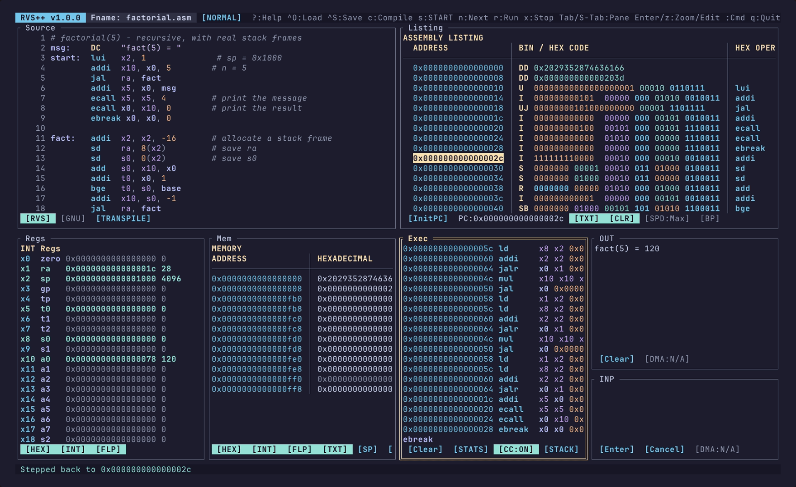
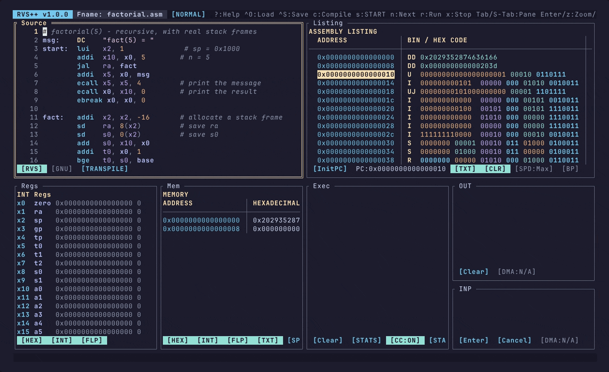
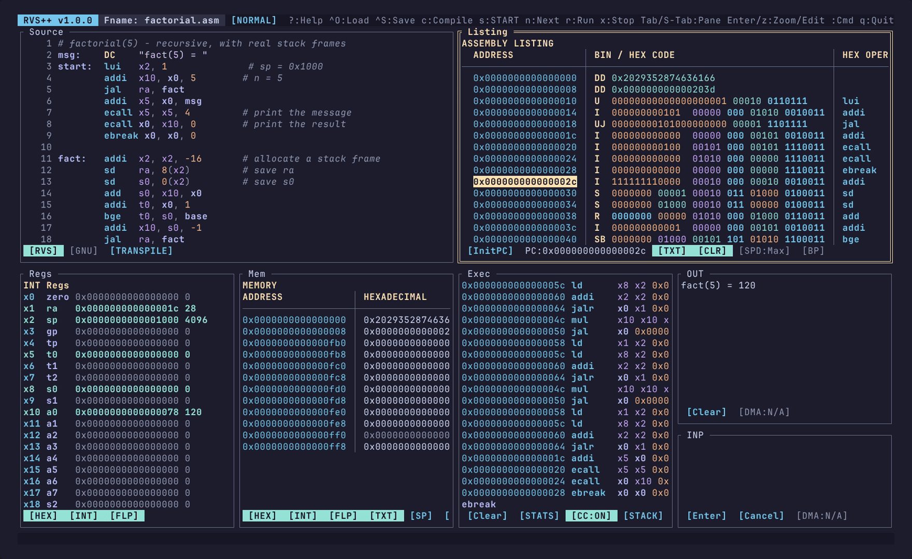
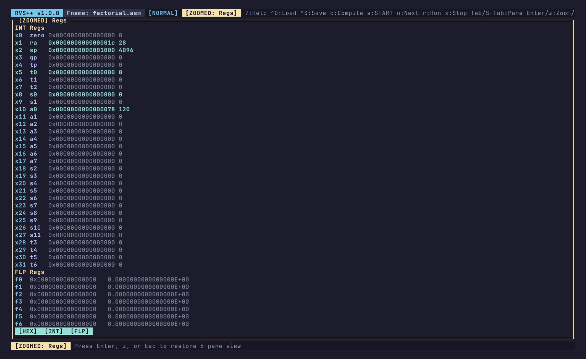
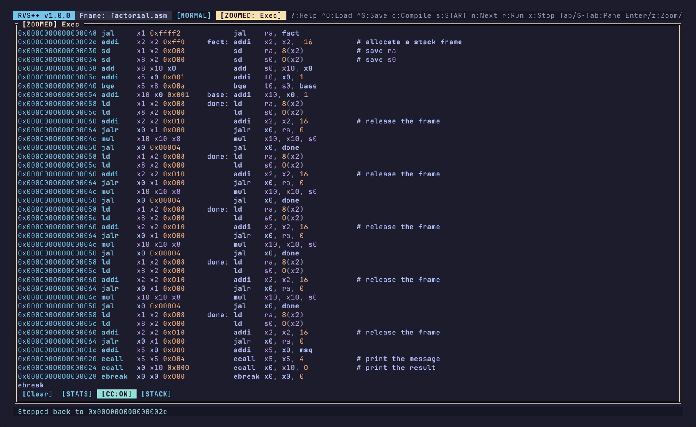
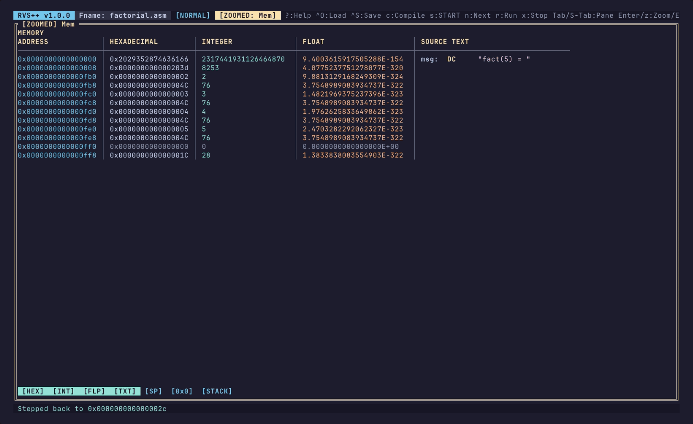
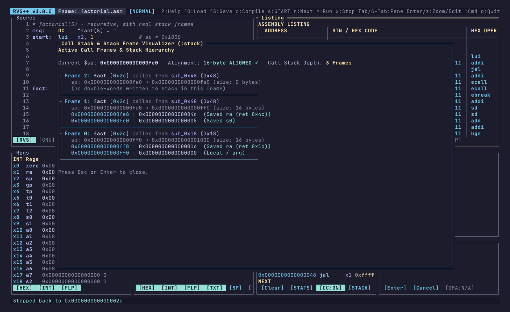
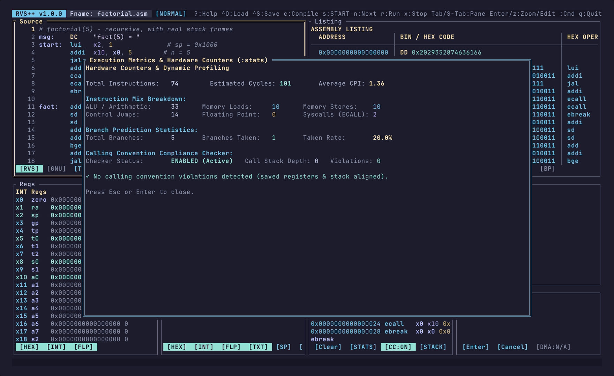
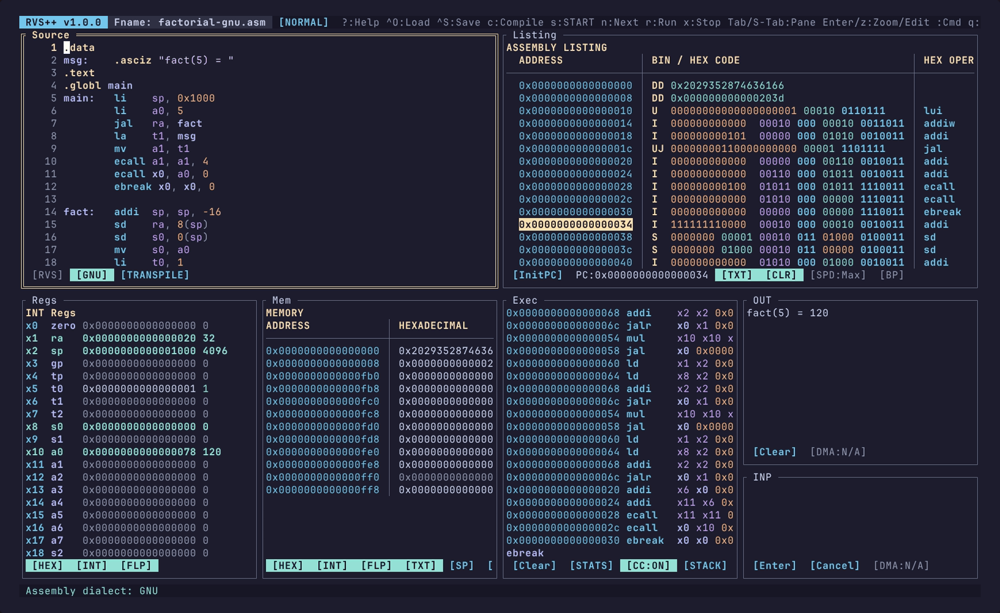
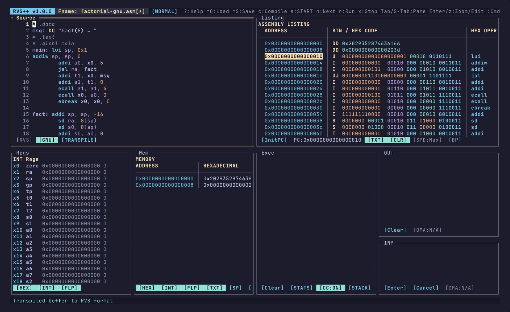

# RVS++ (RISC-V Visual Simulator++)

[](#vibe-ware-notice)

> **Vibe-Ware Notice**: This project is **vibe-ware** — rapidly designed and iterated with AI-assisted engineering, refactored into a clean production Rust architecture, and verified for full behavioral and assembly parity against the original RVS reference simulator.

[](https://github.com/gsmith-alvarez/rvspp/releases)
[](LICENSE)

An interactive terminal RISC-V simulator and debugger written in Rust, built as a drop-in replacement for the 2019 educational simulator `RVS046.tcl` used in university computer architecture courses: real Vim modal editing, reversible execution, live calling convention checking, call stack inspection, and no runtime dependencies (no Tcl, Tk, Java, X11 or browser).

> **What this is:** a debugger for the *RVS course dialect* (RV64 integer + M + a subset of F/D), with byte-exact `kkbatch` report parity and a syntax-level GNU mode bolted on.
> **What this is not:** a general RISC-V ISA simulator. No atomics, no compressed instructions, no executed CSRs, no traps/privilege/VM, no ELF or GCC output, one hart. See [Scope & Limitations](#scope--limitations).



### Demo

Compile, step, rewind, inspect the call stack, then run to completion with live counters:



### Listing Pane
Machine code, hex/int operands and the source line, with correlated bit-field colouring:



### Registers
All 64 integer and floating-point registers, in hex, int and float views:



### Exec Pane
Every retired instruction with its resolved operands, plus the calling-convention linter:



### Mem Pane
Sparse memory view — here, the stack frames left behind by each recursion level:



### Call Stack Visualiser
Active frames, saved `ra`/`s0` slots and the 16-byte `$sp` alignment check:



### Hardware Counters
Cycles, CPI, branch prediction, memory traffic and instruction mix:



### Transpiling
Write standard GNU assembly (`.asciz`, `li`, `mv`, `ret`, `j` …):



…then expand it to canonical RVS dialect in place with `:transpile rvs`:



<sub>Screenshots and the demo GIF are rendered from the real TUI with [VHS](https://github.com/charmbracelet/vhs); see [`docs/`](docs/) to regenerate them.</sub>


---

## Why We Built RVS++

If you've taken a Computer Organization course, you've probably had to use **RVS v0.46** (an educational simulator written in 2019 in Tcl/Tk).

The goal was simple: practice writing RISC-V assembly and get comfortable with computer architecture concepts. But actually using RVS day-to-day was frustrating:

- **Can't use standard code**: When practicing problems or looking up examples online, everything uses standard RISC-V pseudo-instructions (`li`, `mv`, `ret`, `call`) and GNU directives (`.word`, `.dword`). Lectures teach you these concepts, but RVS outright rejects them with syntax errors. You're forced into a rigid, non-standard dialect (`DD`, `DW`, `DC`, raw `addi x0, ...`).
- **Clunky UI & horizontal scrollbars**: The Listing and Memory views weren't real aligned tables; they were just manually spaced text. You were constantly wrestling with awkward horizontal scrollbars just to see what an instruction was doing.
- **Painful to run locally**: Getting RVS to run on a personal laptop is like pulling teeth. It was only designed for university lab machines, and its legacy Tcl/Tk dependencies conflict with almost every modern operating system (macOS, modern Linux distributions).
- **Missing basic editor features**: The built-in editor didn't even support standard editing shortcuts like `Ctrl+Backspace`.
- **Zero debugging safety nets**: Stepping past a bug meant restarting the entire program from scratch. Forgetting 16-byte stack pointer alignment or clobbering saved registers (`s0`–`s11`) would silently cost you marks on autograders with zero diagnostic feedback.

After using Nix to finally wrestle RVS onto my machine, I thought of all those vibe-coded Rust tools people make. A lot of them are slop, but honestly, even that slop was better than this. So why not make a simulator that runs on modern hardware without fighting your OS, gives you decent ergonomics like Vim keys, and actually lets you work on your labs?

Like C++ to C, **RVS++** takes that familiar simulator and gives it a ground-up modernization:

- **Runs on a lab box or over SSH**: one Rust binary, no Tcl, Tk, X11, Java or browser. Builds and is tested on Linux and macOS; Windows is WSL only (the native Windows path is untested).
- **Feels like a real editor**: Vim modal editing (`Normal`, `Insert`, `Command`), full motion keys (`h/j/k/l`, `w/b`, `0/$`, `gg/G`), `dd`/`yy`/`p`, multi-level undo/redo, `Ctrl+Backspace` / `Ctrl+W`, and an `$EDITOR` shortcut (`Enter`) to hand off to Neovim.
- **Proper aligned tables**: Clean tabular views with vertical dividers and correlated bitfield-to-operand color coding (`[CLR]`), so you never have to fight horizontal scrollbars.
- **Actual debugging tools**: Breakpoints with line markers (`● `), conditional breakpoints (`:b loop if s0 == 3`), watchpoints that stop the run when a cell changes, step over/out (`:next`, `:finish`), reverse stepping (`p` to rewind time from a 128-state history), and adjustable run speeds (`1Hz` up to `Max`) with live multi-pane animation.
- **Reverse stepping that stays fast**: history snapshots are deltas (registers + a mark into a memory undo journal), not full state copies — 500k steps rewind in ~100 ms instead of degrading as the trace grows.
- **Real GNU programs run**: with `--abi a7` (or `:abi a7`) `ecall` uses the RARS/GNU convention (`a7` selects the call, `a0`/`a1` carry arguments), so `li a7, 4; ecall` prints a string and `li a7, 10; ecall` exits.
- **Catches assignment bugs early**: An automated calling convention linter (`:cc`) that alerts you if `$sp` isn't 16-byte aligned or if a function modifies callee-saved registers (`s0`–`s11`) without restoring them.
- **Call stack visualizer**: Press `[STACK]` or run `:stack` to see your active call frames, stack memory slots, return addresses, and saved registers.
- **GNU mode & two-way transpiler**: Write GNU *syntax* — directives (`.word`, `.asciz`, `.zero`, …) and 25+ pseudo-instructions (`li`, `mv`, `call`, `j`, `ret`, …) — or convert between GNU and canonical RVS dialect with one click (`[TRANSPILE]`) before submitting assignments. This is a source-level dialect conversion, not a GNU toolchain: with the default `rvs` syscall ABI `ecall` keeps RVS semantics (`a7` is ignored; use `--abi a7` for the RARS/GNU convention), numeric branch operands are read as absolute targets, and there is no libc, linker, `.include` or macro support.
- **Autograder parity**: Headless batch mode (`--batch`) reproduces the original `kkbatch` report byte-for-byte on the bundled conformance fixtures (t1–t5, t7–t9). t6 deliberately exercises instructions this rewrite adds and is smoke-tested only. Parity is verified by `tests/differential/run.sh`, which diffs against the Tcl reference.
---

## Quick Start

### 1. Requirements
All you need is a standard Rust toolchain (1.80+ — the TUI uses `std::sync::LazyLock`):
```bash
# If you don't have Rust installed:
curl --proto '=https' --tlsv1.2 -sSf https://sh.rustup.rs | sh
```

### 2. Run Directly
```bash
# Launch the interactive simulator:
cargo run --release

# Or preload an assembly file:
cargo run --release -- tests/differential/t1.asm
```

You can also use the bundled `./run.sh` script, which automatically picks the fastest available target:
```bash
./run.sh [optional_file.s]
```

### 3. Build a Standalone Binary
```bash
cargo build --release
./target/release/rvs [file.s]
```

### 4. Install Globally
```bash
cargo install --path crates/rvs-tui
# Now you can run `rvs` or `rvspp` from anywhere:
rvs solution.s
```

### 5. Uninstall
```bash
# If installed via Cargo:
cargo uninstall rvs-tui

# If binaries were copied manually:
rm -f ~/.local/bin/rvs ~/.local/bin/rvspp        # or /usr/local/bin/rvs /usr/local/bin/rvspp
```

To remove residual crash recovery buffers (if any):
```bash
rm -rf ~/.local/share/rvs                      # macOS: ~/Library/Application\ Support/rvs
```

---

## Running on Nix / NixOS

If you use Nix or NixOS, flakes and `nix-shell` are supported out of the box:

```bash
# Run directly via Nix Flakes:
nix run .

# Run with an assembly file:
nix run . -- tests/differential/t1.asm

# Enter a dev shell with all tools available:
nix develop
```

---

## Controls & Keybindings

### Global Navigation
| Key | Action |
| :--- | :--- |
| `Tab` / `Shift+Tab` | Cycle focus between panes forward / backward |
| `Enter` | **Source pane**: Opens buffer in your `$EDITOR` (`nvim`), reloading on exit.<br>**Other panes**: Toggles fullscreen zoom.<br>**INP pane**: Submits input. |
| `z` | Toggle fullscreen zoom on the active pane |
| `:` | Enter Command mode (e.g. `:w`, `:q`, `:c`, `:s`, `:n`, `:r`, `:stats`, `:stack`) |
| `?` | Open the Help / Shortcut reference modal |
| `q` / `Ctrl+C` | Clean exit (prompts to save only if you have unsaved changes) |

### Simulation & Debugging (Normal Mode)
| Key | Action |
| :--- | :--- |
| `c` | **Compile**: Assemble the current source buffer |
| `s` | **START**: Reset PC to `START` address and begin running |
| `n` | **Step**: Execute one instruction forward (or `:n <count>`) |
| `:next` / `:finish` | **Step over** a call / **run out** of the current function |
| `p` / `P` / `N` | **Step Back / Prev**: Rewind simulator by 1 instruction (128-state history) |
| `/` then `Ctrl+N` / `Ctrl+P` | Search the source buffer, then repeat next / previous match |
| `r` | **Run**: Execute continuously until `ebreak`, error, stop, or breakpoint |
| `x` | **Stop**: Halt continuous execution |
| `B` | **Breakpoint (Source)**: Toggle breakpoint on current cursor line (red `● `) |
| `b` | **Breakpoint (Listing)**: Toggle breakpoint on current PC |
| `+` / `]` | **Speed Up**: Increase animation speed (`1Hz` $\to$ `5Hz` $\to$ `20Hz` $\to$ `Max`) |
| `-` / `[` | **Slow Down**: Decrease animation speed |

### Vim Editing in Source Pane
| Key | Action |
| :--- | :--- |
| `h` / `j` / `k` / `l` | Move cursor left, down, up, right |
| `w` / `b` | Jump word forward / backward |
| `0` / `$` | Jump to start / end of line |
| `gg` / `G` | Jump to top / bottom of buffer |
| `i` / `a` | Enter Insert mode at cursor / after cursor (`Esc` returns to Normal) |
| `I` / `A` | Enter Insert mode at line start / line end |
| `o` / `O` | Insert new line below / above and enter Insert mode |
| `x` | Delete character under cursor |
| `dd` | Delete line and copy to yank buffer |
| `yy` / `Y` | Yank (copy) line |
| `p` / `P` | Paste below / above current line |
| `u` / `Ctrl+R` | Undo / Redo buffer edits |
| `Ctrl+D` / `Ctrl+U` | Scroll half-page down / up |

### Bottom Toolbar Buttons
Each pane has an interactive bottom toolbar you can click:

- **`Source`**:
  - `[RVS]`: Switch dialect to canonical RVS mode.
  - `[GNU]`: Switch dialect to standard GNU mode (directives & pseudo-instructions).
  - `[TRANSPILE]`: In-editor two-way transpiler (translates buffer between GNU and RVS syntax in-place and flips mode).
- **`Listing`**:
  - `[TXT]` (key `1`): Toggle raw source text column.
  - `[CLR]` (key `2`): Toggle correlated bitfield-to-operand colorizer.
  - `[SPD:...]`: Cycle run speed (`1Hz`, `5Hz`, `20Hz`, `Max`).
  - `[BP]`: Active breakpoint indicator.
  - `InitPC` (key `0` / `i`): Reset PC to `START` without running.
- **`Regs`**:
  - `[HEX]` (key `1`), `[INT]` (key `2`), `[FLP]` (key `3`): Toggle representation formats.
- **`Mem`**:
  - `[HEX]`, `[INT]`, `[FLP]`, `[TXT]`: Toggle memory data representations.
  - `[SP]`: Jump memory view straight to current `$sp` (`x2`).
  - `[0x0]`: Jump memory view back to address `0x0`.
  - `[STACK]`: Open Call Stack & Stack Frame Visualizer.
- **`Exec`**:
  - `[Clear]`: Clear execution trace log.
  - `[STATS]`: Open Hardware Counters & Metrics modal.
  - `[CC:ON/OFF]`: Toggle Calling Convention compliance checker.
  - `[STACK]`: Open Call Stack Visualizer.
- **`OUT` / `INP`**:
  - `[DMA:ON/OFF]` (key `d`): Toggle DMA active polling.

---

## Highlights & Features

### 1. Interactive Breakpoints (`● `)
Set breakpoints by line number, PC, symbol, or hex address:
- Press `B` in Normal mode on any line in `Source`.
- Or run `:b` (current line), `:b 15`, `:b pc`, `:b main`, or `:b 0x20`.
- Clear all breakpoints with `:cb` or `:clearbreaks`.
- Active breakpoints appear with a bold red `● ` marker in both the `Source` editor and `Listing` table. Continuous execution (`r`) pauses right before executing the breakpoint.

### 2. "Step Back" Reverse Execution (`Prev`)
Made a wrong turn or stepped past the bug? Press `p`, `P`, or `N` to step backward. RVS++ keeps the last 128 steps in a ring buffer; each entry records registers plus a mark into a memory undo journal, so rewinding a store removes it and replay lands on exactly the same state. Cost is independent of program size — 500k stepped instructions rewind in ~100 ms.

### 3. Calling Convention Linter (`:cc`)
Designed specifically to prevent common student pitfalls in computer architecture labs:
- **16-byte alignment**: Verifies `$sp % 16 == 0` on every function call (`jal ra`, `jalr ra`).
- **Callee-saved registers**: Takes a shadow snapshot of registers `s0`–`s11` and `fs0`–`fs11` upon function entry. When the function returns (`jalr zero, ra, 0`), verifies that all saved registers and `$sp` were properly restored.
- Violations are immediately flagged in bright yellow in the `Exec` log (`WARN [Convention]: ...`) and cataloged in the `:stats` modal.

### 4. Call Stack & Stack Frame Visualizer (`:stack`)
Press `[STACK]` or run `:stack` to inspect your active call stack:
- Hierarchical display showing active frames, function names, and caller addresses.
- Inspects double-word memory slots inside each active frame, automatically detecting return addresses (`Saved ra`), preserved callee-saved registers (`Saved s0`..`s11`), and spilled arguments.
- Live stack pointer alignment indicator (`16-byte ALIGNED ✓` or `MISALIGNED ✗`).

### 5. Hardware Counters & Profiling (`:stats`)
Press `[STATS]` or run `:stats` to inspect dynamic execution metrics:
- **Cycle Model & Average CPI**: Tracks 1-cycle ALU ops, branch penalties (+1 for taken branches), load-to-use memory latency (+1), multi-cycle multiply/divide (+2), and `ecall` overhead (+4).
- **Branch Prediction Stats**: Total branches, branches taken, and taken rate (`%`).
- **Memory Traffic**: Total loads and stores retired.
- **Instruction Mix**: Breakdown of ALU, memory, jumps, float, and syscall instructions.

### 6. Standard GNU Mode & Two-Way Transpiler (`:mode`, `:transpile`)
Switch between strict educational syntax and standard GNU RISC-V assembly:
- **GNU Mode (`:mode gnu`)**: Assemble files using standard GNU directives (`.word`, `.dword`, `.half`, `.byte`, `.float`, `.asciz`, `.string`, `.zero`, etc.) and 25+ pseudo-instructions (`li`, `la`, `mv`, `ret`, `call`, `j`, `jr`, `nop`, `not`, `neg`, `beqz`, `bnez`, `bgt`, `ble`, etc.). Linker directives like `.text`, `.data`, `.globl` are gracefully ignored.
- **Two-Way Transpiler (`:transpile [gnu|rvs]`)**: Convert your buffer in-place!
  - `:transpile rvs` expands all pseudo-ops into canonical 3-operand RVS instructions.
  - `:transpile gnu` compresses canonical code back into clean GNU pseudo-instructions.

---

## Scope & Limitations

### Supported target
- RV64I integer base, M multiply/divide (including the W forms), and the F/D subset the reference implements: `fld`/`fsd`, `fadd`/`fsub`/`fmul`/`fdiv`/`fsqrt.d`, `fsgnj*`, `fmin`/`fmax`, `feq`/`flt`/`fle`, `fcvt.l[u].d`, `fcvt.d.l[u]`, `fmv.x.d`/`fmv.d.x`. One hart.
- Execution drives from the parsed instruction cell (mnemonic + operands). The 32-bit encoding in the listing is generated for display and is never decoded, so there is no fetched-instruction semantics.

### Not implemented
- **A** (atomics), **C** (compressed), **Zicsr** semantics (the mnemonics encode, the executor rejects them), `fence`/`fence.i` execution, traps, exceptions, privilege modes, paging, interrupts, timers.
- In the `a7` ABI only the ten syscalls listed above exist; there is no heap allocator beyond `sbrk`, and `read string` requires a double-word-aligned buffer.
- ELF loading, relocations, a linker, `.include`, macros, C/DWARF debugging, multi-file projects.
- Architectural misalignment faults (the memory layer applies the reference's own alignment rules, nothing more).
- Multiple harts, and I/O beyond the reference's two DMA control blocks plus `ecall`.

### Deliberate dialect divergences (Tcl parity — do not "fix")
- Branch operands are **absolute targets**, not PC-relative byte offsets; the encoded immediate is `(target − PC) / 2`.
- Memory is a sparse map of 8-byte `DD` cells; code and data share one address space; loads/stores are byte-addressed inside a cell.
- `ecall rd, rs1, imm` with immediates 0–9 is the entire syscall ABI; `a7` is never consulted.
- Per-byte hex digit case is preserved, because the reference splices register strings into memory.
- Consequence: assembly written for a real RISC-V toolchain will assemble and then behave differently. Use `:transpile` and label-based branches, or `--dialect gnu` with the caveats above.

### Performance and state limits
- Reverse stepping keeps 128 delta snapshots (a register copy plus a journal mark); the journal is trimmed as history rolls over, so cost stays flat (~5M steps/s) and memory is bounded by one window of history.
- Batch mode carries no history. With the trace on it runs ≈0.8M instructions/s and the report grows with the instruction count (10M instructions ≈ 800 MB); use `--no-trace` (3 s, 6 KB) unless the trace itself is the artifact.

### Crash safety
- A panic anywhere in the simulator restores the terminal and writes the editor buffer to `$XDG_DATA_HOME/rvs/recovery-<timestamp>.s` (falling back to the temp dir) before exiting with status 1.

### Status
- v1.1.0, single maintainer. CI runs formatting, lints, tests (Linux/macOS), a release-mode link check and the Tcl parity harness; tagged releases publish prebuilt binaries. The crates are deliberately **not** published to crates.io — install with `cargo install --path crates/rvs-tui`, `cargo build --release`, or `nix run .`.

---

## Colon Command Reference (`:`)

Press `:` in Normal mode to enter Command mode:

| Command | Description |
| :--- | :--- |
| `:w [path]` | Save current file (or Save As if untitled) |
| `:q` | Quit (prompts if there are unsaved changes) |
| `:q!` | Force quit immediately without saving |
| `:wq` / `:x` | Save and quit |
| `:e [path]` | Open file in Yazi-style file explorer (or load path directly) |
| `:c` / `:compile` | Assemble source code |
| `:s` / `:start` | Reset PC to `START` and run |
| `:n [count]` | Step `1` or `count` instructions forward |
| `:p` / `:prev` | Step back / rewind 1 instruction |
| `:r` / `:run` | Run continuously |
| `:stop` / `:halt` | Stop execution |
| `:reset` / `:initpc` | Reset PC to `START` without running |
| `:b [line\|addr\|pc]` | Toggle breakpoint (uses cursor line in Source, or specified target) |
| `:b <target> if <expr>` | Conditional breakpoint — fires only when the expression is non-zero |
| `:cb` / `:clearbreaks` | Clear all breakpoints (and their conditions) |
| `:next` / `:over` | Step over: run the call and stop after it returns |
| `:finish` / `:out` | Run until the current function returns |
| `:watch <sp\|addr\|label>` | Stop when that cell's value changes |
| `:unwatch <target>` / `:cwatch` | Remove one watchpoint / clear all |
| `:search <pattern>` | Same as `/` + Enter |
| `:abi [rvs\|a7]` | Select the `ecall` convention |
| `:speed <1\|5\|20\|max>` | Set execution speed preset |
| `:mem <sp\|addr\|label>` | Jump memory view to stack pointer or address |
| `:color [on\|off]` | Toggle bitfield-to-operand colorizer |
| `:cc [on\|off]` | Toggle calling convention compliance checker |
| `:mode [gnu\|rvs]` | Toggle or set assembly dialect mode |
| `:transpile [gnu\|rvs]` | Transpile buffer in-place between GNU and RVS syntax |
| `:stats` / `:metrics` | Open Execution Metrics & Hardware Counters dialog |
| `:stack` / `:callstack` | Open Call Stack & Stack Frame Visualizer dialog |
| `:zoom` / `:z` | Toggle fullscreen zoom on focused pane |
| `:clear` | Clear `Exec` trace log and `OUT` output |
| `:edit` / `:nvim` | Open current buffer in external `$EDITOR` |
| `:help` / `:h` | Open Help modal |

---

## CLI & Headless Batch Execution

In addition to the interactive TUI, `rvs` works as a headless CLI runner for grading scripts, autograders, and CI pipelines:

```bash
rvs --batch [--dialect auto|rvs|gnu] [--abi rvs|a7] [--no-trace] [--json PATH] [--fail-on-error] \
    [--timeout MS] <asm_file> <input_file> <output_file> [timeout_ms]
```

### Arguments
- `<asm_file>`: Path to the assembly source file.
- `<input_file>`: File containing standard input lines for interactive `ECALL 5..9` or DMA requests (use `/dev/null` if none).
- `<output_file>`: Where the evaluation report is written.
- `[timeout_ms]`: Execution timeout in milliseconds (default: `3000` ms). Prevents runaway loops.
- `--dialect`: `auto` (default) detects GNU files from their directives/pseudo-instructions; `rvs` forces the canonical dialect; `gnu` forces GNU mode. Batch mode used to be RVS-only, which made GNU files ungradeable.
- `--abi`: `rvs` (default, parity) or `a7` (RARS/GNU syscalls: 1 print int, 4 print string, 5 read int, 8 read string, 9 sbrk, 10/17/93 exit, 11 print char, 34 print hex).
- `--no-trace`: Omit the per-instruction trace. On a 10M-instruction loop this turns a 12 s / 800 MB report into 3 s / 6 KB — same execution, same final state.
- `--json PATH`: Also write a machine-readable summary (status, steps, cycles, CPI, registers, memory, output) next to the report. The human report is unchanged, so parity is preserved.
- `--fail-on-error`: Exit `2` when assembly or execution failed (default is `0`, like `kkbatch`, because a report is still written).

Exit status is `0` when the report was written (a program that halts with an execution error still writes a report), `2` with `--fail-on-error`, and `1` on I/O or internal error.

The output report structure matches the original `RVS046.tcl` batch output verbatim:
1. `Load <asm_file>`: Verbatim source code.
2. `Compile`: Assembled listing with encodings and symbols.
3. Initial `MEMORY`: Starting state of data cells.
4. `Run`: Trace log from `START` to `ebreak` or halt.
5. Final `MEMORY`: Memory contents after execution.
6. Final `REGISTERS`: Integer (`x0`–`x31`) and float (`f0`–`f31`) registers.
7. `OUTPUT`: Accumulated text output from `ecall` and DMA.

---

## Testing

```bash
cargo test --workspace          # 91 unit, property and integration tests
cargo fmt --all -- --check      # formatting gate
cargo clippy --workspace --all-targets -- -D warnings   # lint gate
bash tests/differential/run.sh  # Tcl-reference parity gate (t1-t5, t7-t9 must diff clean)
```

All of these run in CI on every pull request (plus a release-mode build that proves every crate and binary links, on Linux and macOS).

What is covered:
- Per-crate unit tests, plus `proptest` properties for the editor cursor and Tcl integer/hex round-trips.
- `crates/rvs-assembler/tests/robustness.rs`: a corpus of malformed programs that must assemble-or-error without panicking, and the guarantees that an unencodable instruction is reported instead of executed.
- `crates/rvs-transpile/tests/roundtrip.rs`: the transpiler is total on arbitrary text, preserves line count, and is idempotent.
- 16 headless TUI tests (including an insta frame snapshot) and 5 full-ISA integration tests.

Known gaps: no CI, no coverage tooling, and the differential harness writes fixed `/tmp/*.out` paths, so don't run two suites concurrently.

---

## License & Accreditations

This project is dual-licensed and honors the educational foundation that made it possible:

- **RVS++ Rust Workspace (`crates/*`)**: A workspace of small, single-responsibility crates — core: `rvs-tcl`, `rvs-regs`, `rvs-memory`, `rvs-transpile`, `rvs-sim`, `rvs-asm-syntax`, `rvs-assembler`, `rvs-fpu`, `rvs-ecall`, `rvs-executor`, `rvs-format`, `rvs-machine`, `rvs-machine-riscv`; TUI: `rvs-editor`, `rvs-explorer`, `rvs-theme`, `rvs-syntax`, `rvs-app`, `rvs-app-keys`, `rvs-app-cmds`, `rvs-ui-panes`, `rvs-ui-modal`, `rvs-ui`, `rvs-tui`. Released under the **MIT License**. See [LICENSE](LICENSE).
- **Original Reference (`src/RVS046.tcl`)**: Copyright (c) 2019 **SIDIC**. Distributed under SIDIC's educational not-for-profit license (reproduced in full in [LICENSE](LICENSE) and within lines 321–325 of `src/RVS046.tcl`).

We gratefully acknowledge SIDIC for the reference simulator and assembly specification that inspired this modernized rewrite.
